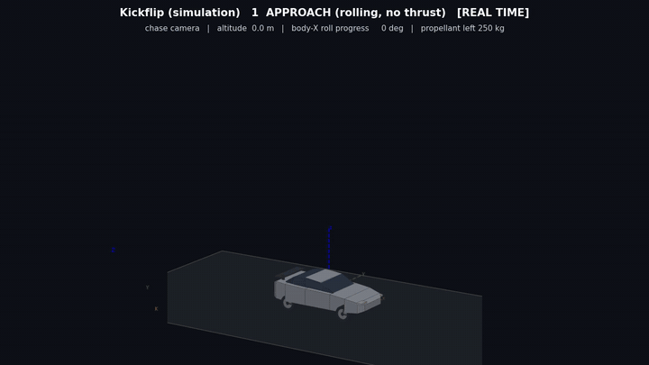
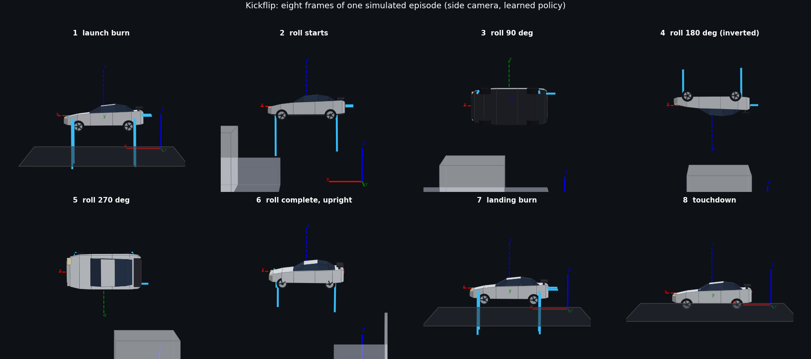
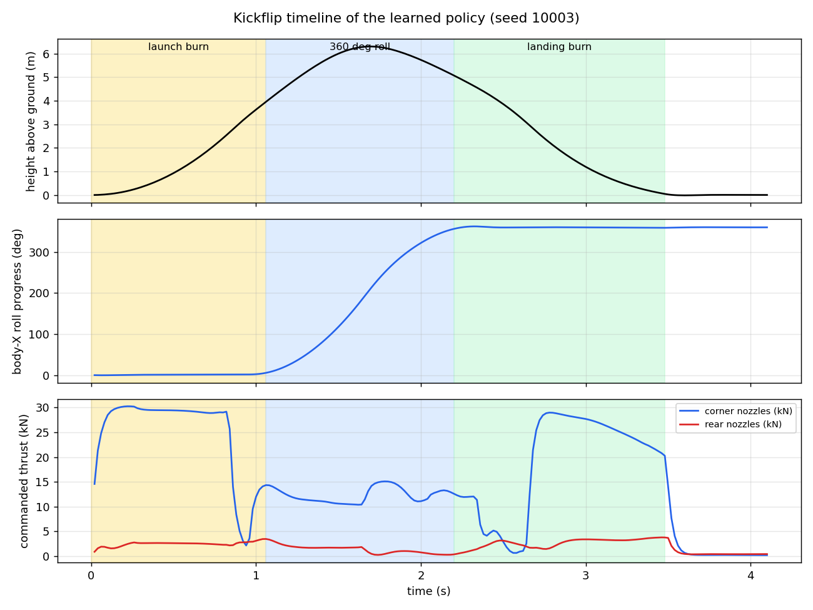
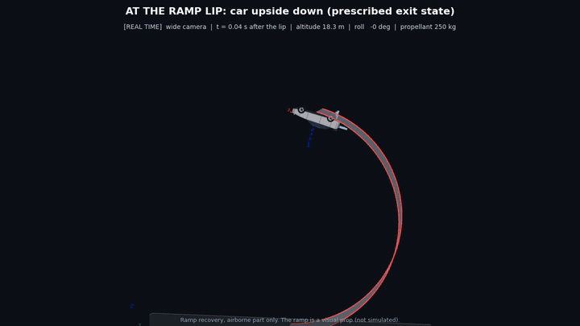
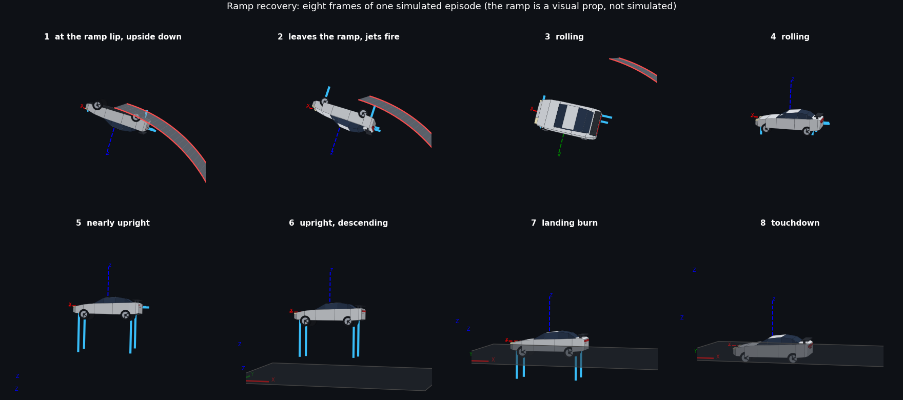
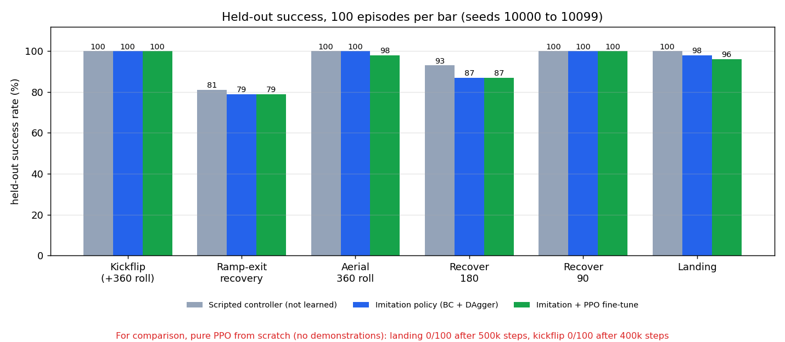
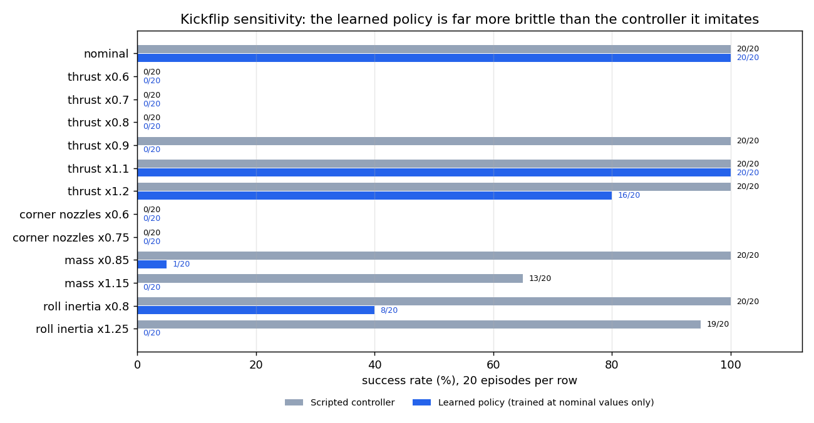
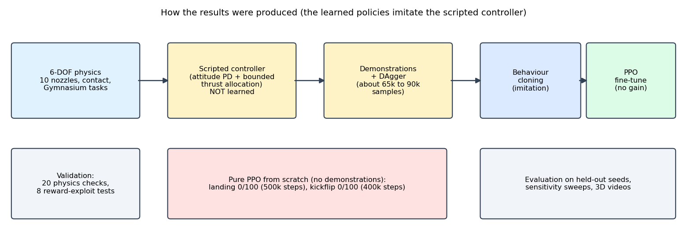
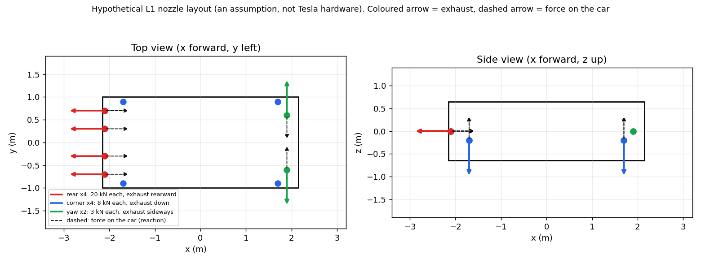

# Roadster-Inspired 3D Reinforcement Learning: Kickflip and Ramp Recovery

[](LICENSE)

[](https://colab.research.google.com/github/fahadiqbal1175/roadster3d-rl/blob/main/notebooks/Roadster_3D_RL_Kickflip_RampRecovery_Colab.ipynb)

A physically consistent **6-DOF rigid-body simulation** of two Roadster-style stunts, with a configurable 10-nozzle thruster model, Gymnasium environments, a NumPy PPO implementation, a classical reference controller, validation tests, reward-exploit tests, and 3D rendering of the simulated state.

> **Disclaimer.** Inspired by public coverage of the Tesla Roadster demonstration. This project does not imply that Tesla uses reinforcement learning or PPO, and it does not recover Tesla's actuators or flight controller. All vehicle numbers other than a few reported event figures are illustrative assumptions, and the 10-nozzle layout ("L1") is hypothetical. This is an independent student project, not affiliated with Tesla. No Tesla footage is included in this repository.



*Kickflip: launch burn, 360 degree roll about the long axis, landing burn, wheels-down touchdown. The orientation comes from the physics simulation, not from a scripted animation.*

## TL;DR

- Two stunts are simulated with one shared physics core: a **kickflip** (ground launch, +360 degree roll, powered flight over an obstacle lineup, landing) and a **ramp recovery** (car leaves a ramp upside down, rolls upright with its jets, lands).
- A **learned policy** lands the kickflip in **100/100** held-out episodes. It was trained by **imitation** (behaviour cloning plus DAgger) of a classical controller I wrote. PPO fine-tuning did not improve it.
- **Pure PPO from scratch did not converge** in my compute budget (one CPU core): 0/100 on landing (500k steps) and 0/100 on the kickflip (400k steps).
- The learned policies are **brittle**: a 10 percent change in thrust or a 15 percent change in mass breaks them, while the classical controller keeps working.

## Contents

1. [The two stunts](#the-two-stunts)
2. [Results](#results)
3. [How it works](#how-it-works)
4. [Validation](#validation)
5. [Reading the footage](#reading-the-footage)
6. [Assumptions](#assumptions)
7. [Limitations](#limitations)
8. [Quick start](#quick-start)
9. [Repository layout](#repository-layout)
10. [FAQ](#faq)

## The two stunts

### 1. Kickflip

The car starts on flat ground rolling at 8 to 10 m/s, burns its corner nozzles to launch, rolls 360 degrees about its long axis, clears a lineup of cars (with a Semi-like block), and lands on its wheels. A full revolution is easy to fake by skipping it, because the end attitude equals the start attitude. The reward and the success test therefore use **signed roll progress** (the unwrapped twist about the body X axis), not just the final attitude.





| Phase (scripted run, seed 3) | Time (s) | Notes |
|---|---|---|
| Launch burn | 0.0 to 0.86 | corner nozzles near full thrust, CoM rises to about 3.6 m |
| 360 degree roll | 0.86 to 2.2 | roll rate peaks at about 9 rad/s, peak height about 6.3 m above ground |
| Upright, descending | 2.2 to 2.6 | attitude settles |
| Landing burn | 2.6 to 3.46 | touchdown speed 0.9 m/s |

Propellant used in this run was about 95 kg of the assumed 250 kg (this depends on the assumed Isp of 70 s).

### 2. Ramp recovery (airborne part only)

The car starts at the ramp lip, upside down (about 170 degrees of ramp-induced pitch, roughly 19 m up), recovers with about 180 degrees of roll about its long axis, and lands. **Ramp contact is not simulated.** The ramp in the images and video is a visual prop derived from the exit state.





A subtle point: a roll about the body X axis does not change the horizontal heading of the car. After about 170 degrees of ramp pitch the car faces back toward where it came from, so the target heading is the **post-ramp** heading, and the success test uses that.

### Videos

| File | Content |
|---|---|
| [`videos/demo_kickflip_full.mp4`](videos/demo_kickflip_full.mp4) | complete kickflip: approach, launch, roll, landing, slow-motion replays (about 30 s) |
| [`videos/demo_ramp_recovery.mp4`](videos/demo_ramp_recovery.mp4) | ramp recovery from the lip, real time and slow motion (about 31 s) |
| [`videos/kickflip.mp4`](videos/kickflip.mp4), [`landing.mp4`](videos/landing.mp4), [`recover180.mp4`](videos/recover180.mp4), [`ramp.mp4`](videos/ramp.mp4) | short four-camera clips of the learned policies |
| [`videos/baseline.mp4`](videos/baseline.mp4) | an untrained network, for contrast (it hits the obstacle at once) |

## Results

Held-out test seeds 10000 to 10099, 100 episodes per bar. Success means every landing criterion was met **and** the maneuver was completed (for the kickflip: signed roll progress within 30 degrees of +360, tilt under 10 degrees, final angular speed under 0.3 rad/s, touchdown vertical speed under 1.5 m/s, lateral slip under 1.5 m/s, heading within 20 degrees, no chassis contact, no obstacle contact).



| Task | Scripted controller (not learned) | Imitation policy (BC + DAgger) | Imitation + PPO fine-tune |
|---|---|---|---|
| Kickflip (+360 deg roll) | 100/100 | 100/100 | 100/100 |
| Ramp-exit recovery (about +180 deg roll) | 81/100 | 79/100 | 79/100 |
| Aerial 360 roll | 100/100 | 100/100 | 98/100 |
| Recover 180 | 93/100 | 87/100 | 87/100 |
| Recover 90 | 100/100 | 100/100 | 100/100 |
| Landing | 100/100 | 98/100 | 96/100 |

**How to read this honestly**

- The learned policies **imitate the scripted controller**. They match it, they do not beat it.
- PPO fine-tuning did **not** measurably help. The selected fine-tuned checkpoints are equal to or slightly worse than the imitation policies.
- **Pure PPO from scratch** (no demonstrations): landing 0/100 after 500k steps, kickflip 0/100 after 400k steps. Not enough budget and no curriculum transfer in this run, so this is not a proof that PPO cannot do it.
- Ramp-exit failures are mostly touchdown speed above 1.5 m/s and chassis contact.
- Everything ran on one CPU core (about 1000 simulation steps per second), in a sandbox. The Colab notebook has not been executed in Colab.

### Sensitivity

Policies were trained at nominal values only. Twenty episodes per row.



The kickflip is only just feasible for this layout: at 0.8x thrust or less even the scripted controller fails. The learned policy is much more brittle than the controller it imitates (thrust x0.9: 0/20 against 20/20, mass x0.85: 1/20 against 20/20). Retraining with randomized mass, inertia and thrust would be the natural next step.

## How it works



### Physics

- Rigid body with quaternion attitude and body angular velocity: `I w_dot = tau - w x (I w)`. The box inertia is about Ixx 806, Iyy 2859, Izz 3186 kg m^2 (roll is the minimum axis, pitch the intermediate axis).
- **Ten body-fixed nozzles**, each with a position, an exhaust direction, a first-order valve lag, a thrust limit and gas consumption.
- **Sign convention:** each nozzle stores its exhaust direction, and the force on the car is the reaction, `F = -f * exhaust_dir`. A plume pointing at the floor pushes the car up when it is upright and **down when it is inverted**. This is covered by unit tests for upright, sideways and inverted attitudes.
- Wheel and chassis contact with spring-damper normal forces and friction. A chassis touching the ground counts as a crash.



### Environment and reward

- Observation (54 numbers): rotation matrix, attitude error to the reference, angular velocity, velocities, reference errors, roll progress, phase, gas fraction, nozzle states, contact flags, obstacle clearance.
- Action: 10 nozzle throttles. The final environment does not use an independent force and torque controller, so force and torque are always coupled through the nozzle layout.
- Reward: dense tracking costs (always non-positive), potential-based shaping with the same discount factor PPO uses (terminal potential 0), and terminal bonuses that are gated by genuine signed roll progress.
- Reference: the attitude reference is `q_ref(t) = q_start * Rx(theta(t))`, with a bang-bang roll profile of 1.4 s for a full revolution. The height reference comes from the simulated scripted run, so it is feasible by construction.

### Learning

1. A classical controller (attitude PD with feed-forward, bounded least-squares nozzle allocation, a landing-burn rule) proves that the layout has the authority for the maneuver. It is **not learned**.
2. Its actions are used as demonstrations. Behaviour cloning plus DAgger (the learner drives, the controller labels) gives the imitation policy.
3. PPO (clip objective, GAE, written in NumPy) fine-tunes it with validation-based checkpoint selection.
4. Pure PPO from scratch is run separately as a baseline.

## Validation

- **20 physics checks** (`roadster3d/test_physics.py`): zero thrust gives exact ballistic motion, balanced nozzles give no torque, torque signs and sizes, integrated roll acceleration, quaternion norm after 100 s of random thrust, conservation of angular momentum and energy for a torque-free tumbling body, a commanded 360 degree roll passes through intermediate orientations, thrust direction in the world for upright, sideways and inverted attitudes, contact energy, rest height, time-step insensitivity, and gas accounting.
- **8 reward-exploit tests** (`roadster3d/exploit_tests.py`): skipping the rotation, premature landing, hovering to timeout, hovering after the roll, and colliding on purpose all score below the genuine maneuver, and none counts as a success.
- **Feasibility record** (`results/feasibility_record_seed3.json`): thrust commands, accelerations, altitude and gas per phase of the scripted kickflip.

## Reading the footage

I extracted frames from the two official clips (not included here) and read them by eye. This is monocular night footage with a moving camera, so the angles are rough.

- **Kickflip:** from a side camera the car shows upright side view, roof, upside-down side view, underside, then upright again, which is what a roll about the long axis looks like. A full revolution took roughly 1.3 to 1.5 s. The jets point along the car body and swing with it.
- **Ramp:** the car leaves the lip upside down, continues to pitch, then an overhead shot shows underside, side, roof, consistent with a roll of about 180 degrees about the long axis. Pitch and roll cannot be fully separated in this footage, and the roll direction is not determined (the project assumes +X).

## Assumptions

| Item | Value used | Source |
|---|---|---|
| Mass | 1700 kg including gas | reported figure (just under 1700 kg), exact value uncertain |
| Gas | 250 kg usable | reported figure |
| Box size | 4.3 x 2.0 x 1.3 m | illustrative |
| Nozzles | L1: 4 rear (20 kN), 4 corner (8 kN), 2 yaw (3 kN) | hypothetical |
| Gas Isp, valve lag | 70 s, 30 ms | assumed |
| Landing gear travel | about 0.23 m | assumed |
| Roll window | 1.4 s | my reading of the footage |
| Lineup | cars 1.6 m high at x 11 to 20 m, Semi-like block 3.5 m high at x 13.5 to 17 m | illustrative |
| Approach speed | 8 to 10 m/s | assumed |

## Limitations

- No ramp contact physics, no aerodynamic drag, no wheel rolling dynamics, and a very simple suspension.
- The car in the videos is a visual mesh. Physics uses a box and wheel contact points.
- Learned policies are imitation policies and are brittle outside the nominal parameters.
- Single seed per training run, no repeated-run statistics for training.
- Pure PPO from scratch was only run with small budgets.

## Quick start

```bash
git clone https://github.com/fahadiqbal1175/roadster3d-rl.git
cd roadster3d-rl
python -m venv .venv && source .venv/bin/activate      # Windows: .venv\Scripts\activate
pip install -r requirements.txt
sudo apt install ffmpeg        # only for video rendering (macOS: brew install ffmpeg)
cd roadster3d
python test_physics.py                    # 20 physics checks
python phase_report.py 3                  # phase-by-phase record of the scripted kickflip
python exploit_tests.py                   # reward-exploit tests
python make_outputs.py video kickflip     # short four-camera video from the shipped checkpoint
python render_demo.py kickflip            # complete demo video (about 30 s)
python render_ramp_demo.py 10018          # ramp recovery demo video
```

Run everything from inside `roadster3d/` (scripts use relative paths). Colab: open `notebooks/Roadster_3D_RL_Kickflip_RampRecovery_Colab.ipynb` and run all cells.

Retraining (single CPU core, about 1000 steps per second):

```bash
python bc_dagger.py kickflip kick_bc.npz
python finetune.py kickflip kick_bc.npz kick_ppo 250000
python scratch_ppo.py kickflip 400000      # pure PPO baseline, expected to fail at this budget
```

## Repository layout

```
roadster3d/            simulator, environments, controllers, PPO, rendering, tests, checkpoints
  sim3d.py             quaternions, nozzle model, contact, integrator
  env3d.py             Gymnasium tasks: landing, recover90/180, roll360, kickflip
  ramp.py              ramp-exit recovery task
  scripted.py          classical reference controller (not learned)
  ppo_np.py            PPO and behaviour cloning in NumPy
  bc_dagger.py         behaviour cloning + DAgger from the scripted controller
  finetune.py          PPO fine-tuning with validation checkpoint selection
  scratch_ppo.py       pure PPO from scratch
  test_physics.py, exploit_tests.py, sensitivity.py, phase_report.py
  render3d.py, render_demo.py, render_ramp_demo.py, make_outputs.py, make_docs_assets.py
  *.npz                checkpoints and the feasible height reference
notebooks/             Colab notebook
results/               RESULTS.md, JSON result files, comparison plots
videos/                demo videos
docs/images, docs/gifs figures used in this README
```

## FAQ

**Is this reinforcement learning?** Partly. The policies that work were trained by imitation learning. PPO (reinforcement learning) was used to fine-tune them and as a from-scratch baseline, and it did not help or did not converge in this budget.

**Is this how Tesla does it?** No one outside Tesla knows from public footage. This project reproduces the visible motion in a physics simulation, with assumed hardware.

**Would it work on a real car?** No. It is a simulation with assumed actuators.

**Why is the ramp not simulated?** Tire contact on a curved ramp is a separate problem that I did not implement. The ramp task starts from the exit state.

**Why are the learned policies so brittle?** They were trained at nominal values only. Randomizing mass, inertia and thrust during training is the obvious next step.

## License

MIT, see [`LICENSE`](LICENSE). Tesla, Roadster, and related names belong to their owners.
